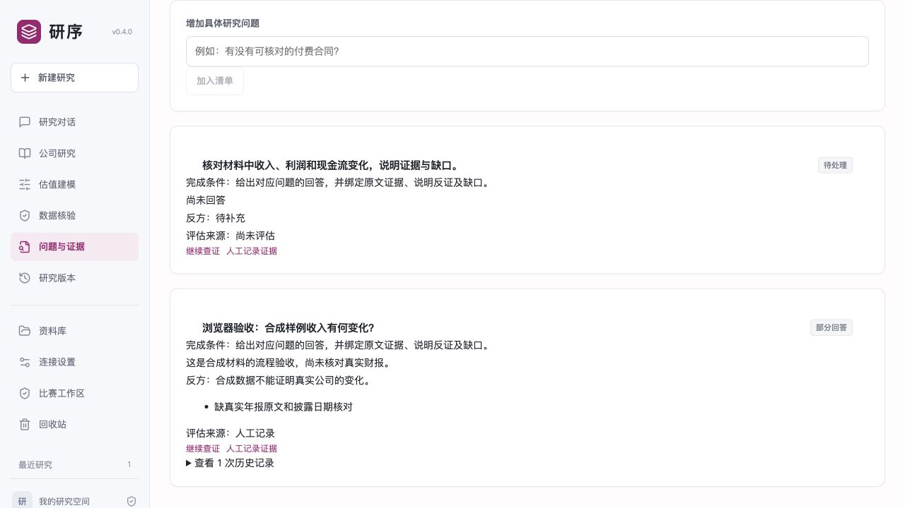

# v0.4.0 本轮验收

2026-10-10，本轮实施范围：文档修订、受控比赛模式、统一事实状态、问题级证据清单。未实现策略回测、实盘交易或完整自动三表建模。

## 环境与自动检查

验收机器为 macOS ARM64、Python 3.13。新建隔离虚拟环境，从仓库 `requirements-lock.txt` 安装全部依赖；`pip check` 无依赖冲突。正式支持的 Windows / Python 3.12 环境仍需另行验证。

运行 `python -m pytest -q`：260 项通过，3 项平台测试跳过。存在一条 Starlette/httpx TestClient 弃用提示，不影响本轮执行。

`npm run build --prefix web` 完成 TypeScript 检查和 Vite 构建。新增文档及 README 的本地 Markdown 链接检查、`git diff --check` 通过。

重点检查：许可按用途/协议/域名/端口区分，禁用网络在 DNS 前阻止，文件与符号链接不能逃逸；材料日期与哈希校验；提交包逐文件哈希及凭据排除；历史不被状态派生覆写；单源可信度表述约束；伪来源/伪摘录拒绝；摘要、未知日期、OCR、冲突、缺答案/反证/证据不能完成问题；来源变更后降级；历史与重复更新；报告和问题原子保存；只读对话限制；HTML 转义。

自动测试采用本地材料、临时数据库与模拟模型/服务，不代表真实模型质量评测。

## 本地流程与浏览器

使用合成 CSV、独立 `var-competition`、无网络许可、未启用模型运行 CLI，任务返回 `completed_with_gaps`，取得六项单源事实并生成提交 ZIP。保留缺口是预期行为；合成数字不属于真实公司财务。

浏览器检查了比赛模式页面、版本与许可、材料创建入口、提交入口和问题清单。新增问题显示待处理；人工保存无证据答案后显示部分回答，完成数量保持 0，保留缺口、评估来源和一条历史。浏览器捕获的 error 日志为空。

## 尚未验证

- 未配置真实模型凭据，未运行真实大模型完整研究；比赛“使用至少一个大语言模型”的要求仍需用真实调用记录证明。
- Windows DPAPI 密钥保存、Windows OCR、PowerShell 启停脚本尚未在 Windows 机器实跑。本轮检查了脚本和工作区健康接口。
- 事实匹配、语句规则和原文绑定不等于专业审计、独立来源确认或金融因果验证。
- 应用层许可不等于操作系统网络隔离；严格比赛环境需配合机器网络配置。

下一轮应以一份可授权使用的真实年报、固定截止日和配置好的模型完成端到端研究，复核问题答案、材料日期、模型失败路径和导出的审计包，再增加独立金融准确率评测。
